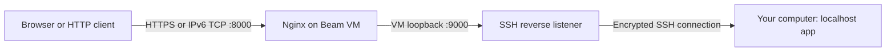

# Share localhost through a Beam VM

Run an app on your computer and share it at a stable public URL. A Beam VM runs Nginx; your computer opens an SSH reverse tunnel to it. `beam-tunnel` stays in your terminal and closes forwarding when you press Ctrl+C.

The public IPv6 address survives VM restarts. The HTTPS URL stays the same while the VM and published port exist. Your local app and computer need to stay running while the tunnel is in use.

## Requirements

- macOS or Linux with Python 3.9+ and OpenSSH on `PATH`.
- The Beam CLI with `beam setup vm`, `beam vm ip`, and `beam vm scp` (install below).
- Internet access to Beam. Direct IPv6 is used when available; the authenticated HTTPS gateway is the automatic fallback. Public HTTPS visitors can use IPv4 or IPv6.
- An Ubuntu/Debian Beam VM with SSH and systemd. The setup command below prepares one.

## Install Beam

```sh
curl -fsSL https://www.beam.cloud/install | sh
```

Then run the recipe commands below from the repository root.

## 1. Prepare the relay VM

```sh
beam setup vm --name tunnel-relay --no-desktop --skip-agents
```

This signs you in if needed and prepares a persistent VM. Beam prompts before creating compute. Default resources are 4 vCPUs, 8 GiB RAM, and a 50 GiB writable disk. The VM keeps running and billing until stopped.

If you already have a prepared VM, substitute its name throughout this recipe.

## 2. Install Nginx and publish port 8000

```sh
beam vm scp recipes/tunnel/setup-relay.sh tunnel-relay:/tmp/beam-tunnel-setup.sh
beam vm exec tunnel-relay bash /tmp/beam-tunnel-setup.sh
beam vm expose --public tunnel-relay 8000
```

The setup script installs Nginx, adds this recipe's relay configuration, and enables it on boot. It uses public port **8000** and forwards to **127.0.0.1:9000** inside the VM. Run it on a dedicated relay VM; port 8000 must be available.

Publishing port 8000 makes the forwarded app publicly accessible. Serve a dedicated app directory; do not run a file server from your home folder.

## 3. Configure your local client

```sh
python3 recipes/tunnel/configure.py tunnel-relay
```

The configuration helper reads your VM's IPv6 address and published HTTPS URL through the installed Beam CLI. It retrieves the SSH host's **public key** using authenticated `beam vm exec`, then pins that key in a local `known_hosts` file.

The helper checks for VM support when selecting the Beam executable. This avoids the older `beam-sdk` command that pyenv or a Python environment may put first on `PATH`. It records the selected executable and optional Beam context for gateway connections. Plain `python3` and `uv run` both work.

To choose an executable explicitly, use `--beam-cli /path/to/beam` or set `BEAM_CLI`.

Generated files live in `~/.config/beam-tunnel/` by default, or under `$XDG_CONFIG_HOME` if set. Your private SSH identity stays on your computer. The default identity is `~/.beam/ssh/vm_ed25519`, created by Beam VM setup.

For another Beam context or identity:

```sh
python3 recipes/tunnel/configure.py tunnel-relay --context my-workspace --identity ~/.ssh/my_vm_key
```

To keep multiple relay configurations:

```sh
python3 recipes/tunnel/configure.py another-relay --config ~/.config/beam-tunnel/another/config.json
./recipes/tunnel/beam-tunnel --config ~/.config/beam-tunnel/another/config.json 8080
```

Rerunning `configure.py` replaces that configuration and its pinned host key using the authenticated Beam connection. [config.example.json](config.example.json) documents the configuration fields. Its example address is for documentation only.

## 4. Start a local app

In one terminal:

```sh
python3 -m http.server 8080 --bind 127.0.0.1 --directory recipes/tunnel/sample
```

This serves the included HTML sample. Edit `recipes/tunnel/sample/index.html` and refresh the public URL to see the change immediately.

You can also use your own app listening on `127.0.0.1`, choosing its port in the next step.

## 5. Open the tunnel

In another terminal:

```sh
./recipes/tunnel/beam-tunnel 8080
```

The terminal shows connection status, the selected transport, your local URL, the public HTTPS URL, the direct IPv6 URL, and elapsed time. It stays in the foreground. **Ctrl+C closes the reverse listener, SSH, and any gateway forwarding process.**

The default `auto` transport uses direct IPv6 when TCP/2222 is reachable, otherwise it uses `beam vm port-forward` to reach SSH through Beam's authenticated HTTPS gateway. Both routes verify the same pinned VM host key. You can choose a route explicitly:

```sh
./recipes/tunnel/beam-tunnel --transport ipv6 8080
./recipes/tunnel/beam-tunnel --transport beam 8080
```

The direct IPv6 URL still requires IPv6 on the visitor's network; the public HTTPS URL works with either transport.

Running `./recipes/tunnel/beam-tunnel` without arguments prompts for a port; the default is 3030. `--help` lists options. Output uses colors in a supported terminal and respects `NO_COLOR`; redirected output contains no terminal escape sequences.

Optional: install a convenient symlink, if `~/.local/bin/beam-tunnel` is available:

```sh
mkdir -p ~/.local/bin
ln -s "$PWD/recipes/tunnel/beam-tunnel" ~/.local/bin/beam-tunnel
```

Keep the checkout in place and add `~/.local/bin` to your shell's `PATH` if needed.

## How it works



Your computer initiates SSH to the VM on port **2222**, either directly over IPv6 or through a managed localhost bridge to Beam's HTTPS gateway. The reverse listener binds only to VM loopback. Nginx handles public HTTP traffic and WebSocket upgrades, with buffering disabled for streaming and a 10 MiB request-body limit.

Nginx sends `Host: localhost` and forwards the original host in `X-Forwarded-Host`. Some frameworks need their trusted-proxy settings configured to use the forwarded headers.

The CLI disables SSH agent forwarding, validates the pinned VM host key, and checks that the local port is listening before replacing an existing tunnel. A second session using the same configuration replaces the previous one. A separate configuration pointing at the same VM reverse port will contend for that port; only one can own it.

The CLI waits for the VM to accept the reverse listener before displaying `connected`. At shutdown it cancels that listener and confirms the cancellation reached the VM before closing the transport.

## Validate

Copy the public URL printed by `beam-tunnel`:

```sh
curl -fsS http://127.0.0.1:8080/ -o /tmp/beam-tunnel-local.html
curl -fsS 'YOUR_PUBLIC_URL' -o /tmp/beam-tunnel-public.html
cmp /tmp/beam-tunnel-local.html /tmp/beam-tunnel-public.html
```

`cmp` exits successfully without output when the content is identical. Press Ctrl+C in the tunnel terminal, then request the public URL again: the relay should return **502** while your local server continues working.

For a persistence check, stop and start the VM:

```sh
beam vm ip tunnel-relay
beam vm stop tunnel-relay
beam vm start tunnel-relay
beam vm ip tunnel-relay
./recipes/tunnel/beam-tunnel 8080
```

Wait for SSH to become ready before reconnecting. The two IP commands should print the same address. Active SSH connections do not survive a VM shutdown.

The original demo was tested with real HTTP GET/POST, WebSocket echo, live local edits, VM stop/start, foreground Ctrl+C shutdown, and stopping from another terminal. The recipe's tunnel CLI was also validated against a real Beam relay before publishing. Automated local checks are in `tests/` and GitHub Actions. HTTP streaming is configured but has not been separately measured.

## Cleanup

- Press Ctrl+C in the tunnel terminal, or run `./recipes/tunnel/beam-tunnel --stop` from another terminal using the same configuration.
- Press Ctrl+C in the local HTTP server terminal.
- Stop VM compute: `beam vm stop tunnel-relay`. Closing the tunnel does **not** stop the VM.
- Optional: remove your generated local configuration and the installed symlink when no longer needed.

## Troubleshooting

| Symptom | What to check |
| --- | --- |
| `Nothing is listening on localhost` | Start the app first. It must accept connections on `127.0.0.1` at the selected port. |
| `No such command 'vm'` when using Python | The older Beam SDK executable may be first on Python's `PATH`. The helper now skips it automatically; `BEAM_CLI=/path/to/beam` overrides selection. |
| Public URL returns 502 | The VM's Nginx cannot reach your app: start the tunnel, check the local app, and check your SSH/network connection. |
| SSH says `No route to host` | Leave transport on `auto` or choose `--transport beam`. Use `--transport ipv6` only when the client has an IPv6 route to the VM. |
| Gateway reports `VM removed`, or public URL returns 404 | The configured relay has been deleted. Prepare or choose a relay VM, then rerun `configure.py` for its current address and host key. |
| `remote port forwarding failed` | Another tunnel owns VM port 9000. Close it from its original terminal or with its `--stop` command. |
| Host key verification failed | Confirm the VM and Beam context, then rerun `configure.py` to pin the current key through the authenticated API. |
| HTML server appears to show JSON | Check the actual `index.html`: Python serves that file's contents; the filename does not convert JSON to HTML. |
| `304` in Python's logs | Normal browser caching: the file has not changed. |
| Favicon returns 404 | Normal for this sample; it has no favicon. |

If the computer sleeps or the tunnel session ends, rerun it after connectivity returns. Automatic transport selection does not restart an ended SSH session.
